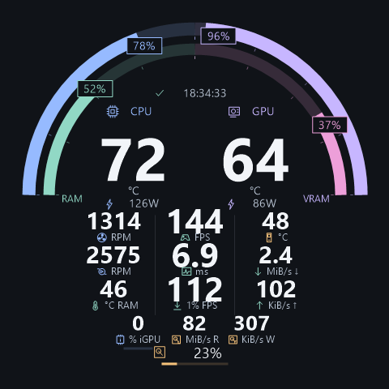

# SamaLite

轻量的 Windows C# 托盘监控程序，为兼容的 SAMA / Turing 圆形 USB 屏幕显示 CPU、GPU 温度与占用、内存占比和采样时刻。默认每秒刷新一次，支持局部画面更新。

当前版本：0.6.1。免安装目录包，设置和日志随程序携带，支持登录后静默提权启动。圆屏上半区使用CPU/RAM、GPU/VRAM双层粗环；中央温度大数字，下半区按散热、帧表现、网络/存储分组，保留12个可配置指标槽。未实现调速、ARGB或固件升级。

## 使用

1. 从托盘彻底退出SAMA，释放屏幕工作串口。
2. 安装 [官方签名的 PawnIO 驱动](https://pawnio.eu/)，用于 LibreHardwareMonitor 的 CPU 硬件访问。验证环境使用 PawnIO 2.2.0；本项目不会自动安装驱动或修改驱动权限。
3. 解压ZIP，放在固定、可写的目录，打开SamaLite/SamaLite.exe（源码构建默认为app/SamaLite.exe）。普通启动不请求管理员权限；CPU温度缺失时仍保留其他读数。需要硬件访问权限时可通过右键菜单主动以管理员权限重启，取消UAC会保留原实例。
4. 程序位于系统托盘（可能在隐藏图标中）。单击或双击均打开同一个快捷面板，右键打开原生菜单；面板内可打开唯一主窗口。关闭窗口继续在后台运行，Esc或点击外部关闭快捷面板。
5. 面板与主窗口支持暂停/恢复、亮度与1/2/5秒刷新。主窗口提供安装方向、关注条件、自动重连和诊断。保留原有设置；默认亮度保持设备现值，验证设备的270°补偿不改变。

## 工作站概览与状态

圆屏固定480×480像素。上半区左侧外环CPU、内环RAM，右侧外环GPU、内环VRAM；外环16px、内环14px，均从左右水平侧的0%向顶端12点方向的100%增长。CPU蓝、RAM绿、GPU紫、VRAM粉；14px百分比靠近进度末端随动，拥挤时用短引线避让，不互相叠字或遮住温度。可关闭环带，改为固定紧凑百分比行。

CPU/GPU温度居中左右排列，从38px放大为74px，功耗就近放在下方。默认左下为风扇/水泵/DIMM温度，中央为FPS/帧时间/1% Low，右下为NVMe/上下行；最底部补核显与磁盘读写，保留磁盘活动条。下半区使用直线分隔、30px普通数字和最高42px中央数字，图标/单位位于数字下方；不使用第二组大环，便于区别于上半区。核显与磁盘活动用紧凑直条。负载趋势仍在桌面保留120秒，不再占用圆屏主区。正常状态保留勾形与真实基础采样时刻；暂停双竖线与冻结时刻，异常三角形，失效/过期改为—。不自动轮播。

主窗口的“屏幕布局与数据源…”提供硬件总览、游戏、散热3种预设；12槽可逐一选择15种指标，按从左到右、从上到下排列，中央前三行有更大的数字。已保存的自定义槽位保持原顺序；未保存布局时使用新的分组默认值。可指定CPU风扇/水泵接口、NVMe、网卡和游戏进程名，保存在data/settings.json；预览使用最近实机数据。通用Fan #不会自动猜用途；只有明确命名CPU Fan及Pump/Pump Fan才自动匹配，仍应按主板实际接线确认。CPU/GPU温度、上半区占比和底部磁盘活动保持固定。正常、100%/100°C、125°C DIMM、150°C NVMe、60000 RPM/ms、大吞吐、零值、缺失与3种预设均检查在r216安全圆内；大于等于10000的扩展读数用k缩写，小于1 MiB/s的非零吞吐切为KiB/s，低于10的吞吐读数保留1位小数。



桌面概览压缩到568 DIP内展示CPU、GPU、RAM、VRAM和iGPU：CPU/GPU负载58 DIP、温度50 DIP，RAM/VRAM占比48 DIP。CPU/GPU卡片同时保留报告时钟、功耗与↑温度采样峰值；iGPU显示最忙引擎、共享内存与报告时钟。详细页改为按硬件分组的多列数字网格，去除重复来源和说明行；悬停可查看完整来源、含义、采样年龄和失败原因。缺失显示—及警告形状，旧值保留时钟/旧标记。图标有文字替代描述，保留必要的设备标识、单位和操作名称。

采集与屏幕输出分别运行。每项指标独立保存来源、最后成功时间、单调时钟和失败原因；年龄超过max(3T,5秒)即过期。失败显示“—”，桌面保留可辨识的旧值和年龄。圆屏内存总量表示系统可用物理总量，安装容量在桌面另行读取；不推算安装容量，不将CPU/GPU功耗称为整机功耗。

“最近发送的画面”只在完整发送成功后替换，采用锁保护的固定像素缓冲；窗口按需取得独立位图，不逐帧压缩PNG。它是本机发送记录，设备画面无法回读。暂停时尽力发送带绝对时间的暂停终态，之后冻结输出，桌面采集继续。标记发送失败保留上次成功预览并说明屏幕可能停在旧画面。恢复直接发送当前帧。重连使用2/5/15/30秒退避，并保留暂停意图；手动重连共用同一输出任务。退出尽力发送静态结束页，不承诺关屏。

主窗口为每监视器DPI感知，960×760 DIP起始尺寸，窄于860 DIP切换单列，内容允许滚动，长中文按实际宽度换行。只更新可见窗口，无高频动画。托盘图标提供16/20/24/32像素资源及静态状态形状；应用ICO另含48/64/128/256尺寸。

CPU≥90°C持续15秒、GPU≥80°C持续15秒、内存≥90%持续30秒会提示关注；低于各阈值5度/百分点并持续30秒恢复。可编辑或关闭；这些是界面观察提示，不是硬件安全线。意外断开持续30秒可通知一次，稳定恢复60秒才重置事件；可关闭，不主动打开窗口。进程榜未加入本版。

## 帧、转速与IO（0.6.0）

- 帧事件：固定官方PresentMon console 2.6.0，仅980320字节，无GUI、服务、RTSS或自解压。目标程序存在时才创建隐藏子进程，直接读取stdout，不写CSV。默认跟随当前活动程序，排除常见桌面、浏览器和开发工具；指定进程名可在切出游戏后继续采集。关闭帧采集则停止自有会话。多个交换链只选活动最多的主链，切进程/主链重置窗口。
- FPS/平均帧时间：最近1秒逐帧应用Present间隔的倒数/平均值。1% Low=1000÷最慢ceil(N×1%)帧间隔的均值，窗口最多60秒、120000帧，至少100帧和5秒才显示。不能从每秒FPS日志推算；缺事件不填零，不保留有效FPS。此口径不是实际显示FPS、刷新率或插帧后FPS。PresentMon权限/驱动/游戏支持可能影响可用性，研究依据见docs/research/2026-10-21-frame-capture-integration.md。
- 转速：LHM/PawnIO读取主板Super I/O接口，每5秒采样，CPU Fan/Pump Fan各自显示。0 RPM可能为停转策略，不判定故障。本机Nuvoton NCT6687D已实测两个明确命名输入约1314/2575 RPM；名称说明主板接口，不证明物理接线。
- NVMe：Windows IOCTL_STORAGE_QUERY_PROPERTY只读SMART/Health日志，每10秒采样，Kelvin换算为°C；这是综合温度，不是主控热点或NAND单独温度。可选具体磁盘；本机Samsung 990 PRO与aigo P7000Z均返回有效温度。
- 网络：所选单网卡收发字节差分，不累加物理/虚拟网卡；自动选择带网关活动网卡，优先避开已识别VPN/虚拟适配器，复杂路由可手动指定。切网卡、计数重置或长间隔先等待新的基线。
- 磁盘：原生PDH英文计数器PhysicalDisk(_Total)，显示全部物理盘聚合读写MiB/s和100−Idle Time的活动百分比；与所选NVMe温度分开。活动率不是队列长度或瓶颈诊断。

2026-10-21管理员后台受控实测：永不显示的16×16 DXGI窗口发出948次Present，采集到同PID/交换链有效事件，末次约59.79 FPS、16.73 ms、51.92 FPS的1% Low。测试程序从未出现主窗口，退出后无SamaLite自有ETW残留；这是受控采集链路验证，未代替真实游戏兼容性验证。

## 扩展硬件详情（0.3.0）

CPU、GPU和内存概览增加CPU Package功耗、独显显存/板卡功耗、逐条内存温度与安装容量。CPU核显独立显示，不替换RTX独显。点击“硬件详情”查看模组、核显引擎/共享内存和CPU核心/线程负载、温度及报告时钟；悬停查看各项来源、更新时间与错误原因，CPU核心详情默认折叠。

扩展数据每5秒采样，超过15秒标旧值，单项失败保留上次成功时间。0.4.0圆屏加入这些扩展值，缺失或过期时只将该槽替换为—；其他读数继续。最忙核显引擎要求已枚举引擎全部可读，避免某引擎缺失时误报0%。开发和验收无需显示主窗口；默认验证仅绘制离屏控件。

- 内存温度：LHM 0.9.6通过现有PawnIO访问DIMM SPD温度传感器，未新增驱动安装。仅采集实时温度，排除分辨率、阈值等同样标为Temperature的常量。检查底层UpdateSensor成功标记，避免LHM读取失败时缓存值被标为新鲜。DIMM索引与Windows插槽名分别展示，不推断两者对应关系。
- 安装容量与模组：启动时读取Win32_PhysicalMemory的原始Capacity、DeviceLocator、Manufacturer、PartNumber。安装容量合计与系统可用物理总量分开，不从47.7 GiB推算48 GiB。
- 显存：优先NVML v2，显示原始已分配、系统保留、剩余和总量；“已用”合计为已分配加保留，百分比使用该合计除以总量。旧驱动回退v1时注明口径。WDDM由Windows管理，不能称为进程显存之和。字节转换为GiB，NVML错误、不支持与暂不可用分别处理。
- CPU核显：仅接受LHM明确标记为Intel Integrated的设备；不把Intel独显误认核显，也不把未枚举推断为BIOS禁用。逐引擎负载不相加，0%是有效零值；共享内存属于系统RAM。D3D查询/能量采样未推进时不刷新相应字段时间。未命名引擎保留独立编号。
- 只读扩展：CPU Package功耗、RTX板卡功耗、视频编解码引擎、风扇相对速度及报告时钟。RTX 4080 SUPER的NVML功耗为约1秒平均值，不是整机功耗；显存报告时钟不等于有效数据率；CPU报告时钟不等于有效频率。未添加风扇或功耗控制。

API依据：[LHM固定版本的DIMM实现](https://github.com/LibreHardwareMonitor/LibreHardwareMonitor/blob/v0.9.6/LibreHardwareMonitorLib/Hardware/Memory/DimmMemory.cs)、[LHM的PawnIO适配](https://github.com/LibreHardwareMonitor/LibreHardwareMonitor/blob/v0.9.6/LibreHardwareMonitorLib/RAMSPDToolkitDriver.cs)、[Intel核显实现](https://github.com/LibreHardwareMonitor/LibreHardwareMonitor/blob/v0.9.6/LibreHardwareMonitorLib/Hardware/Gpu/IntelIntegratedGpu.cs)、[NVIDIA NVML接口](https://docs.nvidia.com/deploy/nvml-api/latest/api/group__nvmlDeviceQueries.html)、[NVIDIA官方头文件的内存结构](https://github.com/NVIDIA/go-nvml/blob/main/pkg/nvml/nvml.h)。

要求Windows x64、.NET 10 Windows Desktop Runtime。发布方式复用系统运行时，不把运行时打进自解压EXE。原SAMA的自启设置不会自动修改。再次运行SAMA前先退出SamaLite，两个程序不能同时占用屏幕。

设备自动识别1D6B:0121工作串口与1A86:CA21辅助接口，不固定写死COM3。发现多个相同型号串口时会停止选择并提示；仅支持本机验证的480×480家族，不能据此宣布支持全部SAMA产品。

## 数据与资源

设置、最近状态、错误日志保存在EXE旁的data/，不再向%LOCALAPPDATA%/SamaLite写应用数据。旧版设置可在退出旧版后复制到data/settings.json；不会在未知目录静默回退写入。错误日志1 MiB轮转，最多保留当前与一份备份；相同错误至少间隔一分钟记录。status.json每15秒覆盖，直接流式序列化；同目录的.new文件用于原子替换，文件数不会随运行时长累积。窗口关闭后释放桌面位图。

这是复用本机依赖的免安装目录版，不是零依赖程序：.NET 10桌面运行时和独立PawnIO驱动须已存在；本包不会安装它们。DLL在程序目录直接加载，Build.ps1显式关闭单文件打包及原生库/全部内容自解压。Windows自身的预取、安全扫描、驱动缓存等系统行为不在“程序目录可删除”的承诺内。

后台内存策略：关闭LHM默认的逐传感器全天历史，只保留应用自己的120秒曲线；重用最近成功帧的像素缓存；仅为可见窗口创建预览；使用工作站GC及ConserveMemory=7。没有定时EmptyWorkingSet、强制GC或人为工作集上限。工作集包含共享DLL页，与私有提交分别测量，不能把分页后的任务管理器数字当作实际内存释放。

2026-10-21本机短测（同样先运行25秒，再每秒采样、持续30秒，无主窗口，1秒刷新）：0.4.0平均工作集143.25 MiB、私有提交88.25 MiB、总CPU 0.276%；0.5.0平均工作集137.44 MiB、私有提交87.93 MiB、总CPU 0.189%。工作集约下降4%，私有提交基本未变，不能把这次短测外推为长期上限。随后由计划任务启动的实例另一次30秒平均工作集143.36 MiB、私有提交92.20 MiB、总CPU 0.141%，显示暖机与GC阶段仍会带来波动。0.6.0增加主板转速、NVMe与IO后的候选版同口径短测为147.60 MiB工作集、93.30 MiB私有提交、0.152%总CPU，未启用帧采集子进程；它没有达到旧SAMA约55 MB工作集。逐帧历史仅收到有效帧后分配，窗口有固定上限；游戏采集时PresentMon子进程的资源还需另计。

目录版实测：约61秒内监控单独的TEMP/TMP和.NET解包路径，创建/重命名事件及残留文件均为0；旧版AppData文件未变化。注册的登录任务已手动触发，实际进程为提权用户会话实例且没有主窗口；CPU/DIMM/核显/显存读数有效、完成帧持续推进、needReSend:0。重复启动静默退出、后台正常退出请求均通过。未通过重启整机来验收登录触发。

实现依据：[.NET单文件与临时解包](https://learn.microsoft.com/en-us/dotnet/core/deploying/single-file/overview)、[LHM固定版本的历史开关](https://github.com/LibreHardwareMonitor/LibreHardwareMonitor/blob/v0.9.6/LibreHardwareMonitorLib/Hardware/Sensor.cs)、[Windows工作集定义](https://learn.microsoft.com/en-us/windows/win32/procthread/process-working-set)。

## 开机启动

在管理员PowerShell 7中执行发布目录内的`./Startup.ps1 -Action Enable`。创建名为`SamaLite-<当前用户SID>`的任务：当前用户登录15秒后，在用户桌面会话中以最高权限直接运行`SamaLite.exe --startup`，不储存密码，不打开主窗口；电池供电可运行，无默认72小时限制，忽略重复任务实例。应用自身仍有单实例锁。Windows登录前不显示托盘，所以使用登录触发而不是Session 0系统服务。

`./Startup.ps1 -Action Status`查询配置；`./Startup.ps1 -Action Disable`移除该任务。普通运行/解压本身不会设置自启。移动程序目录前先移除任务，再在新目录重新启用。`SamaLite.exe --exit`请求同用户实例正常退出；向提权实例发送退出请求也可能需要管理员权限。`--startup`下重复启动和初始化失败均不弹窗。

## 实测验证与范围

以下为0.1.0协议与采集器的历史实测。环境：Intel Core i7-14700K、NVIDIA RTX 4080 SUPER、Windows x64、480×480圆屏，工作接口1D6B:0121与辅助接口1A86:CA21。设备固件返回的英寸名称不可靠，不能据此推断实际尺寸。

- HELLO返回chs_5inch.dev1_rom1.88；这个名字不能代表实际屏幕尺寸。
- 480×480四色画面：用户确认颜色正常；补偿方向后用户确认方向与文字正常。
- 全帧BGRA、局部BGR刷新获得needReSend:0状态；10帧测试通过。
- PawnIO安装并以管理员权限运行后，CPU温度、CPU占用、GPU温度、GPU占用、内存读数全部有效。
- 实际托盘进程的暂停停止刷新、恢复、主动重连、正常退出通过；高DPI窗口已做渲染检查。
- 未实际挂起整台电脑或拔插机箱内USB；自动唤醒/断线退避代码存在，但物理断线与睡眠恢复仍待后续观察。

## 开源复用

驱动主体复用MIT项目usausa/turing-smart-screen的RevisionE与RotateOption，固定提交da3063b4bf976519dedd79167af609724859b74e，再适配本机小屏的BGR局部像素和超时/状态检查。CPU温度来自未修改的LibreHardwareMonitorLib 0.9.6，GPU通过本机驱动的NVML只读接口取得。应用、托盘菜单、绘图、重连、设置和状态记录是本次新增代码。

源码和许可证一起交付，详见THIRD-PARTY-NOTICES.md、ThirdParty及app/licenses。Python项目仅作为协议交叉核对资料，没有捆绑Python或复制其驱动源码。

## 编译

使用PowerShell 7运行Build.ps1，需要.NET 10 SDK和NuGet/GitHub网络连接。packages.lock.json锁定NuGet依赖；Fetch-PresentMon.ps1下载固定2.6.0 console并验证SHA256，缓存于.local/dependencies/，连同该tag许可原样复制到tools/PresentMon。Build.ps1不会安装驱动或改动开机设置。

```pwsh
./Build.ps1
```

可指定独立发布目录：`./Build.ps1 -OutputDirectory D:/Dev/SamaLite/.local/next-release`。

`./Package.ps1`在artifacts/生成带版本号的ZIP、干净的SamaLite/目录和逐文件SHA256清单；不打包现有设置、日志、状态或采样记录。使用目录旁的DLL，不运行自解压启动器。

`./Verify.ps1`在后台运行离线检查，不显示窗口、不打开传感器或串口、不写用户设置。覆盖逐项过期、内存分母、历史边界、关注回滞、圆形安全区、局部刷新覆盖、暂停与重连、DIMM失败时间不变、核显零值/部分缺失、GiB转换、NVML结构布局、紧凑概览/详情离屏布局、窄数字槽完整显示100、真实逐帧1% Low算法、120000帧上限、CSV解析、NVMe响应边界、布局归一化、转速映射与布局编辑器离屏构造。当前75项检查通过，包含全部整数占比对的标签避让、两侧顶端100%、七组环带极值栅格与关闭环带的安全区检查。

发布目录的`SamaLite.exe --verify-frames <目录>`是另行明确调用的管理员诊断：创建永不显示的原生DXGI窗口，约16秒受控Present，采集同PID帧并正常关闭会话，将结果写到指定目录；不连接串口或更改用户配置。不代表游戏性能基准。

显式运行`dotnet bin/Release/net10.0-windows/SamaLite.dll --verify-render <目录>`会额外创建测试窗口，生成离线设计样本截图与栅格安全区报告；仅在允许显示测试窗口时使用。已有运行检查覆盖本机200%缩放、宽/窄布局与模拟150%文字及长中文；100/125/150/175/250/300%真实系统缩放、跨屏DPI变更、系统文字放大与实体屏仍待验收。测试样本不会进入生产界面。

输出目录默认app/，生成文件与本地设置不会进入Git。源码入口：Program.cs（启动）、TrayContext.cs（托盘）、DesktopForms.cs（窗口与面板）、Telemetry.cs（指标质量/历史/关注）、MonitorWorker.cs（独立采集与输出）、SensorReader.cs（传感器）、DisplayRenderer.cs（480×480绘图）、ScreenLocator.cs（串口发现）。

开发诊断：--handshake --port COM3 --output <路径>；--sensors --output <路径>；--test-image或--live-test会实际更新屏幕；这些模式退出后释放串口。普通双击启动托盘版。

## 卸载

若启用过自启，先在管理员PowerShell 7中执行程序旁的`./Startup.ps1 -Action Disable`。从托盘退出后删除程序目录即可，data/中的设置随目录删除。旧版遗留的%LOCALAPPDATA%/SamaLite可自行保留或删除，新版不再写入。PawnIO是独立、可被其他监控软件共用的系统驱动，需通过Windows“已安装的应用”单独卸载，不会随本程序删除。
